<a href="https://jacobsoendergaard.com">
  <picture>
    <source media="(prefers-color-scheme: dark)" srcset="assets/banner-dark.svg">
    
  </picture>
</a>

 

<picture><source media="(prefers-color-scheme: dark)" srcset="assets/title-work-dark.svg"></picture>

  <a href="https://calomatic.app"><picture><source media="(prefers-color-scheme: dark)" srcset="assets/card-calomatic-dark.svg"></picture></a>
  <a href="https://pepnote.app"><picture><source media="(prefers-color-scheme: dark)" srcset="assets/card-pepnote-dark.svg"></picture></a>

 

<picture><source media="(prefers-color-scheme: dark)" srcset="assets/title-skills-dark.svg"></picture>

<picture><source media="(prefers-color-scheme: dark)" srcset="assets/skills-dark.svg"></picture>

 

<picture><source media="(prefers-color-scheme: dark)" srcset="assets/title-year-dark.svg"></picture>

<picture><source media="(prefers-color-scheme: dark)" srcset="assets/wall-dark.svg"></picture>

 

<a href="mailto:hi@jacobsoendergaard.com">
  <picture>
    <source media="(prefers-color-scheme: dark)" srcset="assets/talk-dark.svg">
    
  </picture>
</a>

